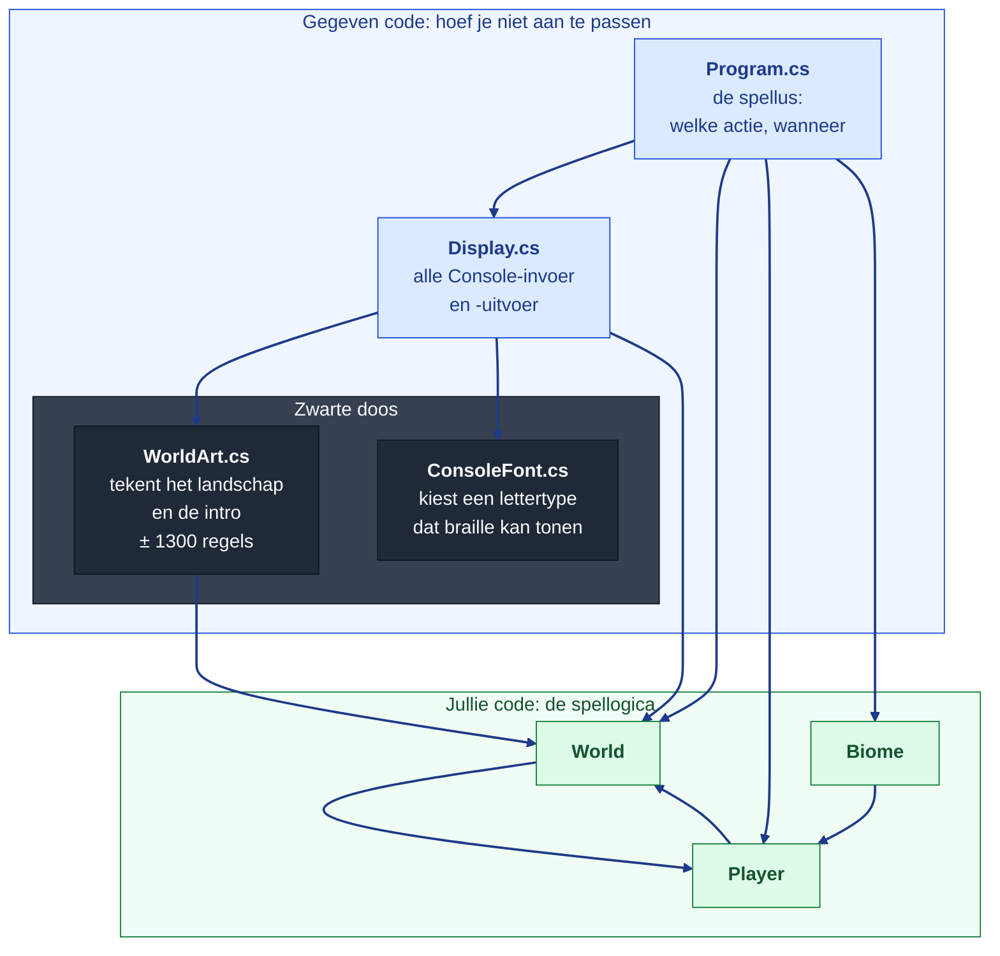
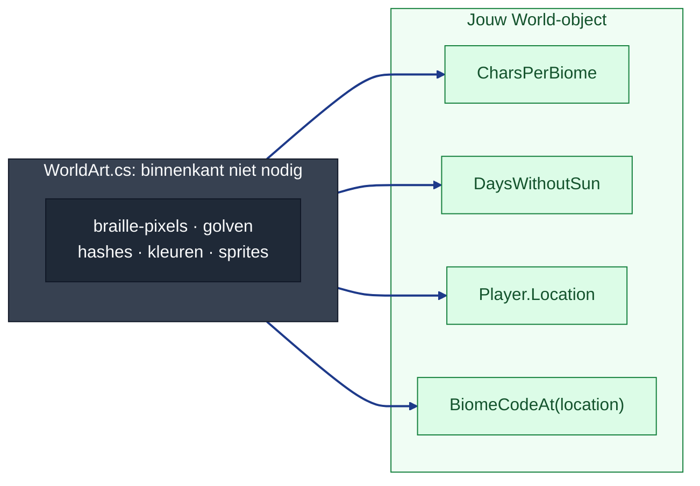
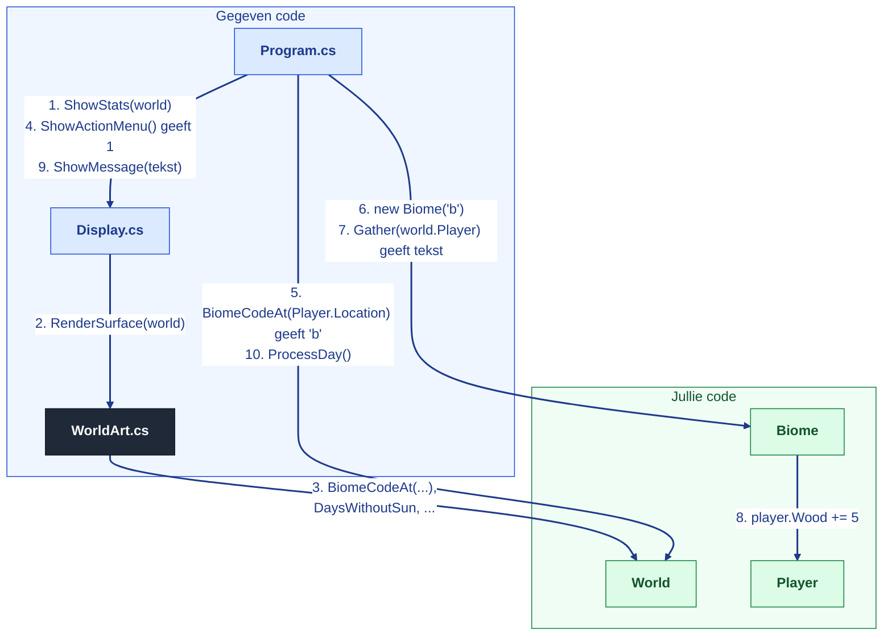

# The Eternal Dark

## Spelconcept

Welkom in **The Eternal Dark**, een tekst-avontuur waarin een eenzame dwerg wakker wordt in een wereld zonder zon. De enige uitweg: het land intrekken, grondstoffen verzamelen, en terugkeren naar het kamp om **een nieuwe zon te bouwen**.

De wereld strekt zich uit naar het westen en het oosten, met de zee als natuurlijke grens. Daartussen liggen verschillende zones, elk met hun eigen grondstoffen. Elke actie (verzamelen, bewegen, bouwen) kost één dag, en hoe langer de zon uitblijft, hoe meer dagen er worden geteld.

## Klassenoverzicht

Het project bevat al werkende code voor het spelverloop, het menu en de ASCII-weergave van de wereld (`Program.cs`, `Display.cs`, `WorldArt.cs`, `ConsoleFont.cs`), maar ontbreekt nog drie kernklassen:

- **`World`** (`World.cs` bestaat al, maar bevat alleen de gegeven methode `BiomeCodeAt`)
- **`Player`**
- **`Biome`**

Open het project via `consolegame.slnx`. Zonder deze klassen compileert het project niet. Elke klasse heeft duidelijke eigenschappen, methodes en constructors die exact volgens de vereisten hieronder moeten worden geïmplementeerd — de bestaande code roept ze op met deze exacte namen.

## Hoe de code in elkaar zit

In dit project schrijf je maar een klein deel van de code zelf. De rest is al geschreven door iemand anders. Dat is in het echte werk heel normaal: meestal werk je in code die collega's (of een AI-agent) geschreven hebben. Je hoeft niet elke regel ervan te begrijpen. Je moet wel weten **welke stukken elkaar gebruiken**, en **wat ze precies van jou verwachten**.

### Twee lagen

Een pijl `A --> B` betekent: *A gebruikt B* (roept een methode van B op of leest een property van B). De kleuren tonen van wie de code is:

- 🟦 **blauw**: gegeven code die je mag lezen
- ⬛ **donker**: gegeven code die je niet hoeft te lezen (de zwarte doos)
- 🟩 **groen**: jullie code



Kijk naar de richting van de pijlen tussen de twee lagen: **ze wijzen allemaal naar beneden.** De gegeven code gebruikt jullie klassen, maar jullie klassen gebruiken de gegeven code nooit. In `World`, `Player` en `Biome` staat dus geen enkele `Console.WriteLine` en geen enkele verwijzing naar `Display` of `WorldArt`. Een methode zoals `Gather` **geeft een `string` terug**, en `Program.cs` geeft die door aan `Display` om te tonen.

Daardoor kan de tekenlaag volledig vervangen worden (andere kleuren, een echt venster in plaats van een console, …) zonder dat er één regel in jullie klassen moet veranderen.

### `WorldArt.cs` is een zwarte doos

`WorldArt.cs` gebruikt technieken die je nog niet gezien hebt: braille-tekens als pixels, sinusgolven, hashfuncties, arrays. **Dat geeft niet.** Je hoeft niet te weten *hoe* het tekent, alleen *wat het van jouw code leest*. En dat is opvallend weinig:



Vier dingen. Zolang die bestaan, met precies die naam en dat type, en de juiste waarde teruggeven, tekent `WorldArt` de wereld. Ook alle andere gegeven code gebruikt maar een handvol properties en methodes van je klassen. Die staan opgesomd onder **Toepassing in `Program.cs`** onderaan.

### Eén dag in het spel

Zo werken de bestanden samen wanneer de speler kiest om te verzamelen (keuze `1`). Volg de nummers:



Let op stap 7 en 9: `Gather` print zelf niets. Het past de speler aan, geeft een tekst terug, en `Program.cs` laat `Display` die tekst tonen.

### Zo lees je code die je niet zelf schreef

1. **Begin bij `Program.cs`.** Dat is het kortste bestand en het vertelt het hele verhaal van het spel.
2. **Spring naar een definitie** (F12 / *Go to Definition*) als je wil weten wat een methode doet. Lees eerst de naam, de parameters, het return-type en de commentaar erboven. Vaak weet je dan al genoeg en hoef je de binnenkant niet te lezen.
3. **Zoek waar iets gebruikt wordt** (Shift+F12 / *Find All References*). Doe dit eens op `BiomeCodeAt`: je vindt het terug in `Program.cs`, `Player`, `Display.cs` én `WorldArt.cs`. Zo zie je meteen waarom de naam exact moet kloppen.
4. **Durf te stoppen.** Als je in `WorldArt.cs` belandt en het wordt wiskunde, ga dan terug. Je weet al wat het van jou nodig heeft.

## Vereisten per klasse

Alle publieke gegevens van je klassen zijn **properties**, geen publieke velden. Een property schrijf je zo:

```csharp
public int Wood { get; set; }
```

Alleen wat **private** is (zoals het `Random`-object `rnd`) mag een gewoon veld zijn: `private Random rnd;`. Constantes schrijf je met `const`, bijvoorbeeld `public const int SunCostWood = 40;`.

### `World`

`World` houdt de speler, de gegenereerde wereld en het aantal dagen zonder zon bij. Er wordt nergens een lijst of array van biomen bijgehouden: `BiomeSeed` is een `string` van één letter per biome.

De methode `char BiomeCodeAt(int location)` staat al in `World.cs`, tussen de commentaarregels `GIVEN CODE`. **Pas die niet aan.** Ze rekent een locatie om naar een letter uit `BiomeSeed`: locatie `0` is het kamp, negatief is west, positief is oost, en alles voorbij de uiteinden is zee (`'d'`). Ze gebruikt `BiomeSeed` en `CharsPerBiome`, die je zelf aanmaakt in **WORLD-01**. Tot dan geeft ze compileerfouten.

| Ticket-ID | Titel | Beschrijving |
|------------|--------|--------------|
| **WORLD-01** | Eigenschappen aanmaken | Maak de publieke properties `BiomeSeed` (`string`), `Player` (`Player`), `DaysWithoutSun` (`int`). Maak ook de publieke constante `CharsPerBiome = 20` (`int`) — hoeveel stappen breed één biome is. |
| **WORLD-02** | Constructor | Implementeer `World(string playerName)`. Deze maakt een privé `Random` veld aan, stelt `BiomeSeed` in via `GenerateBiomeSeed()` (zie **WORLD-03**), maakt een nieuwe `Player` aan met `playerName`, en zet `DaysWithoutSun` op `0`. |
| **WORLD-03** | Methode `GenerateBiomeSeed` | Maak een **private** methode zonder parameters die een willekeurige layout van de wereld teruggeeft. Begin met de pool van biomeletters `"bcef"` (bos, gebergte, kristalpieken, woestijn). Verdeel deze 4 letters **willekeurig en zonder herhaling** over 2 plekken ten westen en 2 plekken ten oosten van het kamp. Geef `"d" + west + "a" + east + "d"` terug — `d` staat voor zee (oneindig aan beide kanten), `a` voor het kamp in het midden. Het resultaat is dus altijd 7 tekens lang, bijvoorbeeld `"dbeafcd"`. *Tip: haal telkens een willekeurige letter uit de pool en verwijder ze daarna, zodat elke letter maar één keer gekozen kan worden.* |
| **WORLD-04** | Methode `ProcessDay` | Maak een **publieke** methode zonder return-waarde die eenmaal wordt aangeroepen per speleractie. Ze verhoogt `DaysWithoutSun` met 1. |

### `Player`

`Player` is de dwerg: alleen plain data en berekeningen, geen `Console`-aanroepen. Elke methode geeft een `string` terug die beschrijft wat er gebeurde — `Display.cs` toont die tekst.

| Ticket-ID | Titel | Beschrijving |
|------------|--------|--------------|
| **PLAYER-01** | Eigenschappen aanmaken | Maak de publieke properties `Name` (`string`), `Wood`, `Iron`, `Crystal`, `Stone` (`int`), `Location` (`int`, negatief = ten westen van kamp, positief = ten oosten, `0` = op het kamp), `SunBuilt` (`bool`). |
| **PLAYER-02** | Constantes | Maak een **private** constante `MoveStep = 5` (hoeveel stappen één beweging is) en vier **publieke** constantes: `SunCostWood = 40`, `SunCostStone = 40`, `SunCostIron = 25`, `SunCostCrystal = 20`. |
| **PLAYER-03** | Constructor | Implementeer `Player(string name)`: stelt `Name` in, alle grondstoffen op `0`, `Location` op `0`, `SunBuilt` op `false`. |
| **PLAYER-04** | Methodes `MoveLeft` / `MoveRight` | Maak `string MoveLeft(World world)` en `string MoveRight(World world)`. Bereken de doellocatie (`Location - MoveStep` resp. `Location + MoveStep`). Is `world.BiomeCodeAt(targetLocation)` gelijk aan `'d'` (zee), verplaats de speler dan **niet** en geef een boodschap terug dat de zee de weg blokkeert. Anders: stel `Location` in op de doellocatie en geef een boodschap terug dat de speler verder trekt. |
| **PLAYER-05** | Methode `StepsToReturnToCamp` | Maak `int StepsToReturnToCamp()` die teruggeeft hoeveel gewone bewegingen de terugtocht naar het kamp zou kosten: `Math.Abs(Location) / MoveStep`. Die deling gaat altijd mooi op, want `Location` verandert altijd met precies `MoveStep`. |
| **PLAYER-06** | Methode `ReturnToCamp` | Maak `string ReturnToCamp()`. Staat de speler al op het kamp (`Location == 0`), geef dan een boodschap terug dat de speler al thuis is. Anders: bereken het aantal stappen via **PLAYER-05**, zet `Location` direct op `0`, en geef een boodschap terug die vermeldt hoeveel dagen de tocht kostte. |
| **PLAYER-07** | Methode `BuildSun` | Maak `string BuildSun()`. Is `SunBuilt` al `true`, geef dan een boodschap terug dat de zon al schijnt. Staat de speler niet op het kamp (`Location != 0`), geef dan een boodschap terug dat hij eerst moet terugkeren. Heeft de speler voldoende van alle vier grondstoffen (`Wood >= SunCostWood`, enzovoort), trek dan de kosten af, zet `SunBuilt` op `true`, en geef een succesboodschap terug. Anders: geef een boodschap terug die vermeldt hoeveel van elke grondstof nog nodig is. |

### `Biome`

Een `Biome`-object stelt één soort gebied voor: het kent zijn eigen lettercode en weet wat je er kan verzamelen. Telkens de speler verzamelt, maakt `Program.cs` een `Biome`-object aan voor de plek waar de speler staat, en roept er `Gather` op aan. Je hoeft hier **niet** elke biome uit `BiomeSeed` een `case` te geven — zie de opmerking onder de tabel.

| Ticket-ID | Titel | Beschrijving |
|------------|--------|--------------|
| **BIOME-01** | Eigenschappen en constructor | Maak een publieke property `Code` (`char`) en een **private** veld `rnd` (`Random`). Implementeer `Biome(char code)`: stelt `Code` in en maakt `rnd` aan met `new Random()`. |
| **BIOME-02** | Methode `RollAmount` | Maak een **private** methode `int RollAmount()` die `rnd.Next(3, 7)` teruggeeft: een willekeurig getal van 3 tot en met 6. |
| **BIOME-03** | Methode `Gather` | Maak `public string Gather(Player player)` met een `switch` op `Code`: <ul><li>`'a'` (kamp): niets te verzamelen, geen wijziging.</li><li>`'b'` (bos): `player.Wood += RollAmount()`.</li><li>`'c'` (gebergte): `player.Stone += RollAmount()` **en** `player.Iron += RollAmount() / 2`.</li><li>`'d'` (zee): niets te verzamelen, geen wijziging.</li><li>`'e'` (kristalpieken): `player.Crystal += RollAmount()`.</li><li>`'f'` (woestijn): `player.Stone += RollAmount()`.</li><li>anders: niets te verzamelen.</li></ul>Geef in elk geval een `string` terug die beschrijft wat er gebeurde (en hoeveel er precies verzameld werd, waar van toepassing) — de exacte bewoording mag je zelf kiezen. |

> **Uitdaging.** De wereld in deze opdracht kent vier biomen waar je iets kan verzamelen. Maar de gegeven code weet meer dan deze opdracht verklapt... Wie ontdekt wat er nog verborgen zit, mag het als bonus toevoegen aan de pool van **WORLD-03** en er een eigen `case` voor schrijven in `Gather`.

## Toepassing in `Program.cs`

Het spel simuleert één dag per actie in een `while`-lus. De al bestaande code gebruikt onder andere:

- `new World(name)` om de wereld en de speler aan te maken.
- `new Biome(world.BiomeCodeAt(world.Player.Location))` en daarna `biome.Gather(world.Player)` om te verzamelen.
- `world.Player.MoveLeft(world)` / `MoveRight(world)` om te bewegen.
- `world.Player.BuildSun()` om de zon te bouwen.
- `world.Player.ReturnToCamp()` / `StepsToReturnToCamp()` om terug te keren, gevolgd door `world.ProcessDay()` zo vaak als er stappen zijn.
- `world.ProcessDay()` na elke actie, en `world.Player.SunBuilt` om te checken of het spel gewonnen is.

Ook `Display.cs` en `WorldArt.cs` gebruiken properties zoals `Player.Wood`, `Player.Location`, `World.DaysWithoutSun` en `World.CharsPerBiome`, en de methode `World.BiomeCodeAt`, rechtstreeks om de wereld te tekenen (zie het diagram bij **`WorldArt.cs` is een zwarte doos**). Het is dus van groot belang dat je de naamgevingen in de tickets hierboven **exact** aanhoudt, anders compileert het project niet.

## Commitrichtlijnen

Elke wijziging of toevoeging hoort bij een specifiek **ticket**. Gebruik duidelijke commitboodschappen volgens dit patroon:

```
WORLD-03: GenerateBiomeSeed genereert nu de biome-layout
PLAYER-04: MoveLeft en MoveRight houden rekening met de zee
BIOME-03: Gather verzamelt grondstoffen per biome
```
